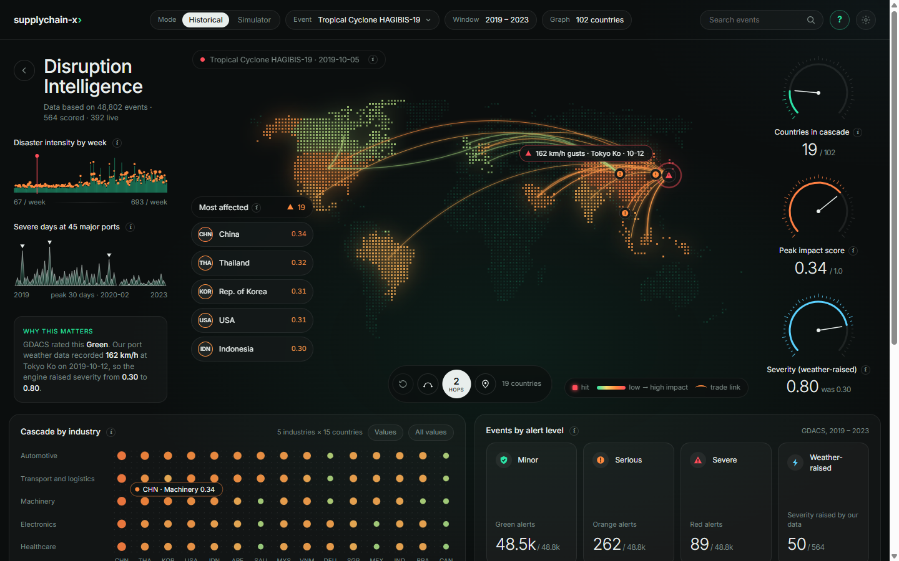
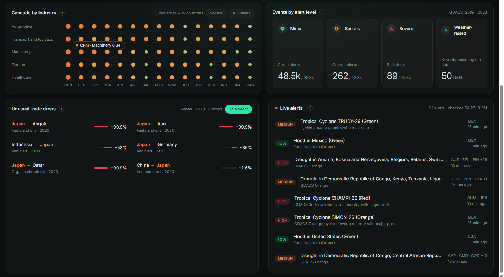
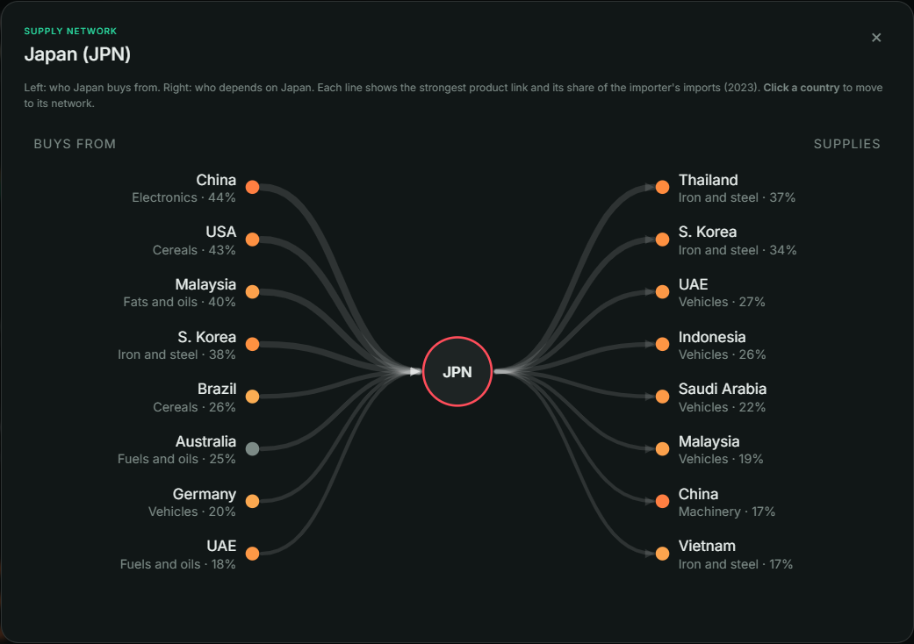

# SUPPLYCHAIN-X

**A distributed big-data platform for supply-chain disruption detection and graph-based cascading impact analysis.**

When a port shuts down, a cyclone hits, or a route gets cut off, the damage rarely stops at that one place.
It moves through whoever depends on it: the commodities that pass through, the countries that import them,
and the industries that need those goods. SUPPLYCHAIN-X tries to make that chain visible.

It brings together trade, weather and disruption-event data, stores it in a Hadoop HDFS data lake,
processes it with Apache Spark (batch) and Kafka + Spark Structured Streaming (live), models the dependencies as a graph in Neo4j, and scores how far
and how hard a disruption is likely to spread.


*Typhoon Hagibis (2019). GDACS rated it Green; our own port weather data found 162 km/h gusts in Tokyo,
so the engine raised its severity and follows the cascade through 19 countries, hop by hop.*

## Research questions

1. Can heterogeneous supply-chain, environmental and event data be integrated through distributed
   batch/stream processing and graph analytics to identify the downstream entities likely to be affected
   by a disruption?
2. Does graph-based dependency analysis give more interpretable disruption-impact results than an
   isolated prediction model?

## Architecture (short version)

```
 Historical data ──> HDFS data lake (Parquet: bronze/silver/gold) ──┐
                                                                   ├──> Spark ──> PostgreSQL / Neo4j / ML ──> Impact engine ──> FastAPI ──> D3 dashboard
 Live GDACS feed ─┐                                                │
 (or a replay) ───┴─> Kafka topics ──> Structured Streaming ───────┘
```

More detail in [docs/architecture.md](docs/architecture.md).

## Stack

| Layer          | Tool                                  |
|----------------|---------------------------------------|
| Storage        | Hadoop HDFS (2 DataNodes) + Parquet, bronze/silver/gold |
| Batch          | Apache Spark cluster (PySpark, Spark SQL), 1 master + 2 workers |
| Baseline       | Hadoop MapReduce on YARN, mapper/reducer in C++ (one job, to compare against Spark) |
| Streaming      | Apache Kafka + Spark Structured Streaming |
| Graph          | Neo4j + Graph Data Science            |
| Relational     | PostgreSQL                            |
| ML             | scikit-learn (Isolation Forest, RF, logistic regression) |
| API            | FastAPI                               |
| Frontend       | D3.js + plain JavaScript (no build step; see docs/architecture.md) |
| Tests          | pytest + FastAPI TestClient (`python -m pytest -q`) |

## Data sources

| Source | What | Scope |
|---|---|---|
| **UN Comtrade** | bilateral trade by product (HS chapter) | 20 reporting economies x 12 chapters, 2019-2023, ~330k rows |
| **GDACS** | natural disasters (earthquakes, cyclones, floods, droughts, volcanoes, wildfires) | 48,827 events 2019-2023, plus a live feed of current events |
| **Open-Meteo** (historical API) | daily weather at the 45 biggest container ports | 2019-2023, 82k port-days |
| **World Port Index** | port locations | 3,805 ports |

## What it does

- **Data lake + batch:** raw downloads land in HDFS (bronze), Spark cleans them with data-quality checks that
  stop a job on bad data (silver) and builds dependency tables (gold) - see [data-quality.md](docs/data-quality.md).
- **Streaming, live:** disaster events flow through Kafka into Spark Structured Streaming, which validates them
  (bad messages -> dead-letter queue), enriches them with ports and downstream dependents, and raises alerts.
  Events come from GDACS live (polled every 10 minutes) or from a replay of 2019-2023 history.
- **Graph + impact engine:** Neo4j holds who supplies whom with what share; the engine follows the links up to
  3 hops and scores every country and industry in the cascade, with every score explainable.
- **Machine learning:** Isolation Forest flags unusual trade drops; a side classifier tries to guess an event's
  alert level from context.
- **Dashboard** (http://localhost:8000): dot-matrix world map with the cascade spreading hop by hop, live alerts,
  a supply-network view per country, unusual trade drops, a what-if simulator and a guided tour.

## Screenshots

| Lower panels | Supply network of a country |
|---|---|
|  |  |
| Which industries are exposed, unusual trade drops linked to the event (Isolation Forest), and live alerts from the Spark stream - here today's real disasters from the GDACS feed. | Click any country on the map: its biggest suppliers (left) and the countries that depend on it (right), from Neo4j. |

## Results at a glance

| Question | Result | Details |
|---|---|---|
| Spark vs MapReduce (same job, same hardware) | Spark **2.0x faster** (17.4 s vs 34.7 s; MapReduce in C++) | [experiments.md](docs/experiments.md) E6 |
| Spark tuning | Parquet 2.9x faster than CSV; broadcast join 1.7x; 8 shuffle partitions 2x faster than 1 | E0-E5 |
| Lose a DataNode | **0 blocks missing**, all 653,082 rows read back with identical checksums | [hdfs-failover-demo.md](docs/hdfs-failover-demo.md) |
| Kill the streaming job mid-stream | resumed from its checkpoint: 1,297 events, **none twice**; 3 of 3 broken messages caught | [streaming.md](docs/streaming.md) |
| Our weather data vs GDACS | raised the severity of 50 of 556 events (Typhoon Hagibis: Green -> 0.8 after 162 km/h gusts at Tokyo) | [graph-and-impact.md](docs/graph-and-impact.md) |
| Does the impact score match real disruptions? | trade dependency helps; graph centrality shows a "hub bias"; with fair statistics **no score variant is proven better** - the engine measures exposure, not confirmed damage | [experiments.md](docs/experiments.md) E9 |
| Unusual trade drops | the strangest are sanctions and wars (Russian fuel 2023, Ukrainian cereals 2022), not storms | E7 |
| Guess alert level from context | macro F1 0.45 vs 0.33 for "always Green" - context can't replace the event's physical size | E8 |

**Research questions, answered briefly:** (1) yes - the pipeline integrates the sources in batch and live and
identifies the downstream countries and industries, each with a traceable chain; (2) the graph-based score is
far more *interpretable* (path + five factors per score), but it was not shown to be more *accurate* on the
small set of documented cases we could find.

## Running it

You need Docker Desktop (give it ~8 GB of RAM) and Python 3.12. Spark and Hadoop run in Docker,
nothing else to install.

```bash
cp .env.example .env                     # then add your COMTRADE_API_KEY
docker compose up -d                     # kafka, postgres, neo4j, hdfs, spark
python -m venv .venv && .venv\Scripts\activate && pip install -r requirements.txt
python scripts/check_services.py         # all five should say [ok]

# phase 1: download the raw data into the local landing zone
python -m ingestion.reference
python -m ingestion.comtrade
python -m ingestion.ports
python -m ingestion.gdacs
python -m ingestion.weather

# put it into HDFS and check Spark can read it
python scripts/hdfs_load_bronze.py
docker exec scx-spark-master /opt/spark/bin/spark-submit /opt/scx/spark_jobs/smoke_test.py

# phase 2: clean bronze -> silver on the Spark cluster (stops if a data-quality check fails)
python scripts/spark_run.py silver

# gold: dependencies, concentration, risk features -> HDFS, then loaded into Postgres
python scripts/spark_run.py gold

# switch off a DataNode and prove nothing is lost (~3 min)
python scripts/hdfs_failover_demo.py

# phase 3: optimisation experiments, then MapReduce (C++ on YARN) vs Spark
python scripts/spark_run.py bench_prepare
python scripts/bench.py
docker compose --profile mapreduce up -d
python scripts/build_mapreduce.py
python scripts/bench_mapreduce.py

# phase 4: live stream (two terminals) - see docs/streaming.md
python scripts/spark_run.py export_replay
python scripts/kafka_topics.py --reset
python scripts/spark_run.py stream_events
python -m ingestion.replay_producer --from 2019-09-01 --to 2019-10-31 --speed 86400 --bad 3
python -m ingestion.live_gdacs                   # or: today's real disasters, polled every 10 min

# phase 5: graph, impact engine, dashboard - see docs/graph-and-impact.md
python scripts/spark_run.py export_graph
python -m graph.load_neo4j
python -m graph.algorithms
python -m impact.run_events
python -m uvicorn api.main:app --port 8000      # open http://localhost:8000

# phase 6: ML + validation - see docs/experiments.md
python -m ml.anomalies
python -m ml.severity
python -m ml.validate

# phase 7: API tests (services must be up)
python -m pytest -q
```

| Service          | URL                      |
|------------------|--------------------------|
| HDFS NameNode    | http://localhost:9870    |
| Spark master     | http://localhost:8081    |
| **Dashboard**    | **http://localhost:8000** |
| API docs         | http://localhost:8000/docs |
| Spark job (live) | http://localhost:4040    |
| YARN (phase 3)   | http://localhost:8088    |
| Kafka UI         | http://localhost:8080    |
| Neo4j            | http://localhost:7474    |
| Postgres         | localhost:5433           |

More on what to look at where: [docs/where-to-look.md](docs/where-to-look.md).

## Docs

| Doc | About |
|---|---|
| [architecture.md](docs/architecture.md) | the pieces and why each one is there |
| [data-quality.md](docs/data-quality.md) | what the silver/gold checks test and what they caught |
| [experiments.md](docs/experiments.md) | all experiments: Spark tuning, MapReduce vs Spark, ML, score validation |
| [streaming.md](docs/streaming.md) | Kafka + Structured Streaming, crash test, live mode |
| [graph-and-impact.md](docs/graph-and-impact.md) | the Neo4j graph, the impact score, the dashboard |
| [hdfs-failover-demo.md](docs/hdfs-failover-demo.md) | losing a DataNode without losing data |
| [demo-script.md](docs/demo-script.md) | a timed 10-minute demo with a backup plan |
| [roadmap.md](docs/roadmap.md) | phase by phase, what was built |

## Project status

**Feature-complete** (phases 0-7 and live mode). See [docs/roadmap.md](docs/roadmap.md).

**Limits, honestly:** 20 reporting economies (trade links only point into those 20), yearly trade data (short
disruptions vanish in a year of totals), 2023 trade links used for every year, weather data to 2023, a small
documented ground truth, and one laptop playing the part of a cluster.
